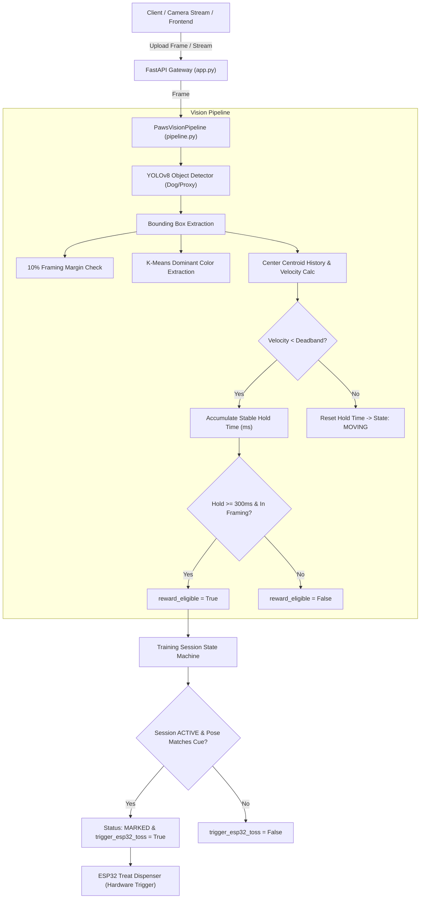
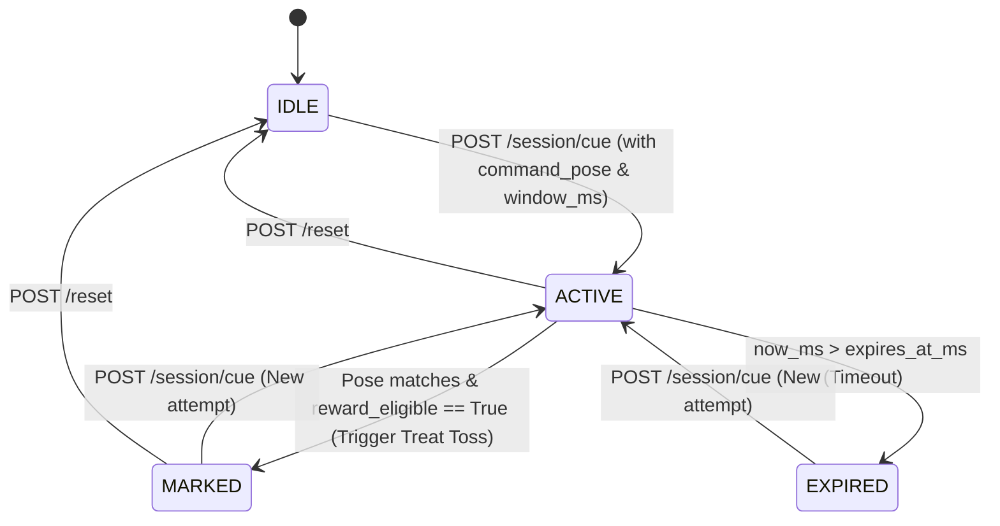

# PAWS Buddy System Architecture

## Architecture Overview

**PAWS Buddy** is an edge-native AI vision service designed to assist in automated pet training and reward delivery. It runs as a containerized FastAPI application with hardware acceleration (Apple Silicon MPS / CUDA / CPU) and integrates real-time object detection with a temporal kinematic state machine.

---

## Data Flow & Processing Pipeline

### 1. Frame Ingestion & Normalization
- Frames arrive via HTTP file upload (`/session/evaluate_frame` or `/predict`) or stream decoder (`/stream/evaluate`).
- Frames are decoded as OpenCV BGR numpy arrays.
- Timestamps are either passed explicitly (`timestamp_ms`) or calculated from the pipeline frame rate (`(frame_counter - 1) * 1000 / fps`).

### 2. Subject Detection & Framing
- `ultralytics.YOLO("yolov8n.pt")` detects target classes (`16=dog`, `0=person`).
- Boundary verification confirms that the bounding box fits within `10%` to `90%` of frame width and height, ensuring the pet is not partially out-of-frame.

### 3. Kinematic Stability & Pose Hold
- Centroid history is tracked across a rolling window (`smooth_window=5`).
- Center displacement over time determines velocity in pixels/second (`vel_px_s`).
- When velocity is below `velocity_deadband_px_s` (120 px/s), posture is categorized as `"SITTING"`.
- If velocity exceeds the threshold, posture is marked as `"MOVING"`, resetting `stable_start_ms`.
- A continuous hold exceeding `hold_gate_ms` (300 ms) inside valid framing sets `reward_eligible = True`.

### 4. Interactive Training Session State Machine

- **One-Reward Guarantee**: The `reward_dispatched` flag guarantees that each unique training `attempt_id` can trigger hardware reward actuation at most once.

---

## Deployment & Container Architecture

- **Engine**: Docker + Docker Compose.
- **Base Image**: `ghcr.io/astral-sh/uv:python3.12-bookworm-slim`.
- **Port Mapping**: Dynamic environment variable interpolation `"${PORT:-8000}:${PORT:-8000}"`.
- **Volume Mounts**:
  - Live source mount (`.:/app`) enables instant code syncing and uvicorn auto-reload without image rebuilds.
  - Anonymous volume mounts (`/app/.venv` and `/app/__pycache__`) isolate container virtual environment binaries from host macOS artifacts.
